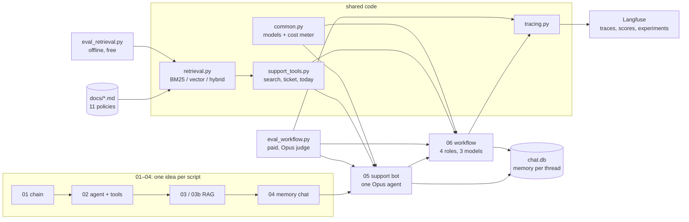
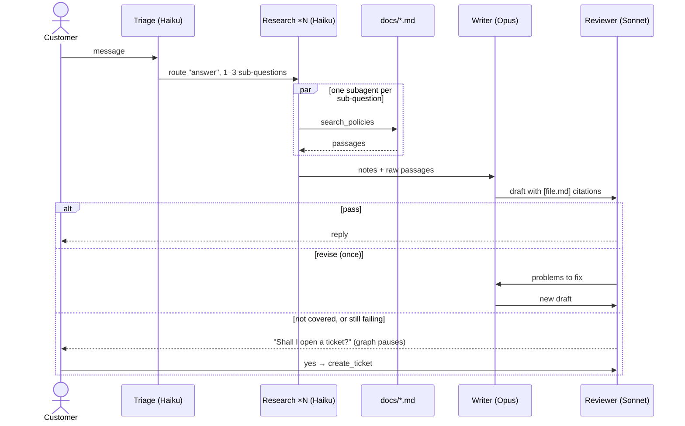

# langchain-claude

[](https://github.com/manshoor/langchain-claude/actions/workflows/ci.yml)

LangChain 1.x on Claude, built up one idea per script and finished with a customer support bot. The bot answers from policy documents, cites its sources, remembers each customer and hands off to a human when the documents have no answer. Retrieval was chosen by measurement, not by default: an offline eval compares keyword, vector and hybrid search.

Then the same bot is rebuilt as a LangGraph workflow that splits each turn across three Claude models (Haiku 5.5 triages and researches in parallel, Opus 5.5 writes, Sonnet 5.5 reviews), traced in Langfuse. A paid eval compares it with the single agent. On these questions the single agent won, and the results say why.

| File | Shows |
| --- | --- |
| `01_chain.py` | Prompt template piped into the model; structured output into a Pydantic model |
| `02_agent.py` | `create_agent` with three local `@tool` functions |
| `03_rag.py` | RAG over `docs/*.md`: load, split, BM25 retrieval, answer with sources |
| `03b_rag_vector.py` | Same RAG with vector search: local fastembed embeddings, `InMemoryVectorStore`, similarity scores printed |
| `04_memory_chat.py` | Multi-turn chat saved to `chat.db` (SQLite) per `--thread`, old turns summarized to cap its size. Tools: `today`, `web_search` (DuckDuckGo), `get_weather` (Open-Meteo) |
| `05_support_bot.py` | **Capstone.** 02 + 03b + 04 in one agent: RAG as a tool, citations, memory, ticket hand-off |
| `06_support_workflow.py` | The bot as a LangGraph `StateGraph`: a model per role, parallel research subagents, review loop, consent pause before a ticket, Langfuse tracing |
| `eval_retrieval.py` | Offline retrieval eval: BM25 vs vector vs hybrid on 24 labeled questions |
| `eval_workflow.py` | Paid eval: 05 vs 06 presets, graded by an Opus judge, run as Langfuse experiments |

Shared code: `common.py` builds the model and meters cost, `retrieval.py` holds loading, splitting and the three search methods, `support_tools.py` holds the tools 05 and 06 share, and `tracing.py` is the only file that talks to Langfuse.

## How it fits together

For an interactive version, open [`workflow.html`](workflow.html) in a browser. It steps through real workflow runs node by node, switches model presets and charts the eval results.



## Support bot architecture

```
customer ──► agent (create_agent) ──► SummarizationMiddleware ──► Claude
                │   tools                (long threads → summary)
                ├── search_policies ──► vector search ──► docs/*.md (11 policies)
                ├── create_ticket   ──► help desk (stub)
                └── today
                │
                ▼
           SqliteSaver ──► chat.db   (one memory per customer thread)
```

The agent decides when to search, can search again with other words, and must cite the file behind each fact. If the policies don't cover a question, it says so and offers a ticket instead of guessing.

Sample run (`uv run 05_support_bot.py`, trimmed):

```
you> Hi, I'm Sara. I bought a laptop 20 days ago and want my money back. Possible?
     call   search_policies({'query': 'refund laptop return window'})
     result search_policies: refund-policy.md, returns-exchanges.md
bot> Hi Sara, yes, you're still eligible. You can ask for a refund within 30 days
     of purchase, and you're at day 20 [refund-policy.md]. ...

you> Can I pick the order up from your Abu Dhabi store instead?
     call   search_policies({'query': 'store pickup Abu Dhabi collect in store'})
     call   search_policies({'query': 'physical store locations drop off return in person'})
bot> Our policies don't mention an Abu Dhabi store or in-store pickup ... Should I
     open a ticket so an agent can check?

you> Yes please, open a ticket for that.
     call   create_ticket({'summary': 'Customer Sara wants a refund ...', 'priority': 'normal'})
bot> I've opened ticket TCK-0001 for you, Sara. ...

you> Thanks. What was my name again?
bot> Your name is Sara.
```

## Multi-model workflow (06)

```
customer message
   │
   ▼
triage ─────────────── Haiku 5.5: route, 1–3 sub-questions, priority
   │ answer            chat → write → reply · handoff → handoff
   ▼
research × N ───────── Haiku 5.5 subagents, in parallel, each with search_policies
   │
   ▼
write ◄──────┐ ─────── Opus 5.5: the reply, with [file.md] citations
   │         │ revise, once
   ▼         │
review ──────┘ ─────── Sonnet 5.5: is every claim backed by a passage?
   │ pass              not covered, or failed twice → handoff
   ▼
reply → END

handoff ────────────── interrupt "Open a ticket?" → yes → create_ticket → END

memory:  SqliteSaver → chat.db, one thread per customer
tracing: Langfuse, one trace per turn, every step and model call nested
```

One answered turn, in time order:



What each library does:

- **LangChain**: the Claude models, tools, `create_agent` for the research subagents, middleware for call limits and refusal fallback.
- **LangGraph**: the graph. Shared state, branching, parallel fan-out with `Send`, the revise loop, `interrupt()` for the customer's consent, checkpoints in SQLite.
- **Langfuse**: one trace per turn with every step and model call nested, cost per model, sessions per customer, scores, and experiment runs for the eval.

| Role | Preset `mixed` | Effort | Why |
| --- | --- | --- | --- |
| Triage | Haiku 5.5 | low | Short classification on every message |
| Research subagent | Haiku 5.5 | medium | Mostly reading; at low effort it skips searches |
| Writer | Opus 5.5 | low | The text the customer reads |
| Reviewer | Sonnet 5.5 | medium | A different model checks each claim |

`--preset opus` puts every role on Opus 5.5, `--preset haiku` every role on Haiku 5.5.

The graph fixes the steps; models only fill them in. So routing is plain code that tests cover without a model, and each turn has a cost ceiling: at most 3 subagents, 4 model steps each, 1 rewrite. Only a refused Haiku step retries on Sonnet; rate limits and other errors don't switch to the pricier model. Only plain text crosses from one role to another, so no model sees another model's thinking or tool calls.

Sample run (`uv run 06_support_workflow.py`, trimmed):

```
you> Hi, I'm Sara. I bought a laptop 20 days ago. Can I get my money back, and how long until it reaches my card?
     triage   answer · normal · ["What is Acme's refund policy for a laptop purchased 20 days ago?", "How long does it take for a refund to appear on the customer's card after it is approved?"]
     research "How long does it take for a refund ..." → refund-policy.md
     research "What is Acme's refund policy ..." → refund-policy.md
     write    draft, 75 words
     review   revise The claim that when the refund shows on the card depends on the card issuer's posting time is not in any passage ...
     write    draft, 61 words
     review   pass
     cost     $0.0217 · 9 model calls (claude-haiku-5-5 ×5, claude-opus-5-5 ×2, claude-sonnet-5-5 ×2) · 14.3s
bot> Hi Sara! Yes, your laptop is eligible. Refunds are available within 30 days of purchase, so you have
     about 10 days left [refund-policy.md]. ... Once approved, the refund goes back to your original payment
     method within 7 business days [refund-policy.md].

you> Can I pick the order up from your Abu Dhabi store instead?
     triage   answer · low · ['Can customers pick up online orders in person from an Acme store, ...?']
     review   not_covered The passages say nothing about in-store pickup ...
bot> Our policies don't cover that. Shall I open a ticket so a human can help?
you> yes
     cost     $0.0105 · 6 model calls (claude-haiku-5-5 ×4, claude-opus-5-5 ×1, claude-sonnet-5-5 ×1) · 9.9s
bot> I've passed this to a human. Ticket TCK-0001 opened (low). A human replies within one business day.

you> Thanks. What was my name again?
     triage   chat · low · []
     cost     $0.0036 · 2 model calls (claude-haiku-5-5 ×1, claude-opus-5-5 ×1) · 3.1s
bot> Your name is Sara, as you mentioned at the start of our chat. ...
```

With Langfuse keys set, each turn also prints a trace link.

## Workflow results: does splitting the work pay off?

`uv run eval_workflow.py`: the same 24 questions, one fresh conversation each, through three systems. An Opus 5.5 judge grades each reply against the full text of the doc that answers it (correct 1, partial 0.5, wrong 0). Run on 2026-11-19 for $1.93, including $0.38 for 72 judge calls.

| System | Judge | Expected doc cited | Handoff | Cost / question | Median time | Model calls |
| --- | --- | --- | --- | --- | --- | --- |
| **05** (one Opus agent) | **0.90** | 100% | 0% | $0.0124 | **3.5 s** | 2.1 |
| 06 `mixed` | 0.83 | 96% | 4% | **$0.0120** | 8.8 s | 6.4 |
| 06 `opus` | 0.81 | 96% | 4% | $0.0401 | 12.6 s | 6.8 |

What the numbers show:

- **On single-doc questions, orchestration doesn't pay.** The single agent gets the best grade at the same cost as `mixed`, about 2.5× faster.
- **Mixing models does cut cost.** `mixed` makes 3× the model calls of 05 for the same money, because Haiku makes most of them. Opus in every role costs 3.3× more and is no better.
- **The review gate costs answers.** "Can I ring you on a Friday?" found nothing in research, the reviewer said "not covered", and the customer got a handoff instead of the phone hours. The same gate stops invented answers; here it was too cautious.
- **Where 06 should help, this set doesn't test:** multi-part questions, real gaps in the docs (05 asks for consent in its reply; 06 pauses the graph and opens the ticket in code), and an audit trail of every step.

Limits: 24 single-doc questions, one run each, and replies vary between runs. The judge is Opus grading replies Opus wrote; grading against the doc text reduces that bias. The judge sees only the expected doc, so a correct fact cited from a second doc counts as unsupported, which hurt both systems.

## Retrieval results

`uv run eval_retrieval.py`: 24 questions over 11 docs (21 chunks). Half reuse the docs' words ("Is shipping free on orders over 200 AED?"), half paraphrase ("How quickly will my parcel reach Riyadh?"). Each question names the doc that answers it.

| Method | Questions | hit@1 | hit@3 | MRR |
| --- | --- | --- | --- | --- |
| BM25 | keyword (12) | 1.00 | 1.00 | 1.00 |
| BM25 | paraphrase (12) | 0.42 | 0.50 | 0.44 |
| vector | keyword (12) | 0.92 | 0.92 | 0.94 |
| vector | paraphrase (12) | **1.00** | **1.00** | **1.00** |
| hybrid (RRF) | keyword (12) | 0.92 | 0.92 | 0.94 |
| hybrid (RRF) | paraphrase (12) | 0.75 | 0.92 | 0.85 |
| **vector** | **all (24)** | **0.96** | **0.96** | **0.97** |
| hybrid (RRF) | all (24) | 0.83 | 0.92 | 0.90 |
| BM25 | all (24) | 0.71 | 0.75 | 0.72 |

hit@k: share of questions whose right doc is in the top k. MRR (mean reciprocal rank): 1.0 means the right doc always ranks first.

What the numbers show:

- **BM25 wins on exact words, fails on paraphrase.** "Riyadh" shares no word with "GCC orders (Saudi Arabia ...)", so keyword search scores nothing.
- **Vector search wins overall.** Its one miss is "Is shipping free on orders over 200 AED?", where the exact number matters more than meaning.
- **Hybrid did not beat vector here.** Reciprocal rank fusion gives both lists an equal vote, so BM25's confident wrong answers on paraphrases pull the right doc down. On a corpus with many codes, SKUs or names, hybrid would likely win. Only measuring tells.
- Two BM25 fixes came from reading failures, and each was measured: dropping chunks that share no word with the question (hybrid MRR 0.80 → 0.83), and removing stop words like "do" and "and" (BM25 0.70 → 0.72, hybrid 0.83 → 0.90).

Limits: 24 hand-written questions on 11 short sample docs. Enough to see clear gaps, too small to trust differences of a few points. The two BM25 fixes were found by reading failures on these same questions, so their gains are measured on tuning data and are optimistic. A held-out question set would give a fair number.

## Setup

Needs [uv](https://docs.astral.sh/uv/) and `ANTHROPIC_API_KEY` in the environment. Langfuse tracing is optional: create a project at [Langfuse Cloud](https://cloud.langfuse.com) (the free Hobby plan is enough) and set `LANGFUSE_PUBLIC_KEY` and `LANGFUSE_SECRET_KEY`. A `.env` file works too; git ignores it:

```sh
set -a && . ./.env && set +a
```

```sh
uv sync
```

## Run

```sh
uv run 01_chain.py
uv run 02_agent.py
uv run 03_rag.py "Who approves refunds over 5000 AED?"
uv run 03b_rag_vector.py "Can I get my money back after a month?"
uv run 04_memory_chat.py                       # scripted demo, starts fresh each run
uv run 04_memory_chat.py --chat                # interactive, resumes thread "main"
uv run 04_memory_chat.py --chat --thread aws   # a separate conversation
uv run 04_memory_chat.py --reset --thread aws  # forget one conversation
uv run 05_support_bot.py                       # scripted support demo
uv run 05_support_bot.py --chat --thread ali   # be the customer
uv run 06_support_workflow.py                  # scripted workflow demo
uv run 06_support_workflow.py --chat --preset opus   # every role on Opus
uv run eval_retrieval.py                       # offline, no API key needed
uv run eval_workflow.py --dry-run              # cost estimate for the paid eval
uv run eval_workflow.py                        # paid: about $2
```

Each script run makes a few API calls (cents at most). `eval_retrieval.py` and the tests make none; `eval_workflow.py` is the one paid eval.

## Tests and CI

```sh
uv run pytest     # 80 offline tests: tools, retrieval, graph routing, tracing, eval scoring
uv run ruff check .
```

The workflow tests run the whole graph with fake roles, so routing, the revise loop, the consent pause and the per-turn reset are all checked without a model.

GitHub Actions runs lint, tests and the retrieval eval on every push, and writes the eval table to the job summary. Nothing in CI calls Claude, so it needs no secret and costs nothing. Model calls are kept out of tests on purpose: their output varies, and every run would cost money.

## Design decisions

- **Every script runs from `main()`** behind `if __name__ == "__main__"`, so tests can import the tools without starting a model or a chat.
- **Tools return errors as text.** `web_search` and `get_weather` catch network failures and tell the model, so one failed HTTP call can't crash a whole conversation. (`get_weather` once let them escape; a test now covers it.)
- **Structured output uses `method="json_schema"`.** The default tool-calling method forces a tool call (`tool_choice`), which Claude Opus 5.5 rejects with a 400.
- **No `temperature`.** Current Claude models reject sampling parameters.
- **Server-side fallback is on** (`fallbacks: "default"` in `common.py`): if a safety classifier refuses a request, the API retries it on another model instead of failing. Haiku 5.5 has no server-side fallback, so `make_model` leaves it off there and 06 retries Haiku refusals on Sonnet in code.
- **Workflow state holds plain values** (dicts, strings, messages). LangGraph warns it will soon refuse to load custom classes from checkpoints, so 06 uses `TypedDict`s, not Pydantic models.
- **Tracing never fails a turn.** `tracing.py` logs and ignores any Langfuse error, and does nothing without keys. It drops the Anthropic SDK's own OpenTelemetry spans; without that, every model call showed up twice and Langfuse doubled the cost.
- **A failed chat turn continues instead of starting over.** After an API error, `--chat` offers to continue the turn from its last checkpoint, so research that already ran isn't paid for twice and the message isn't added twice.
- **06 threads are stored as `06:<name>`** in `chat.db`, so `--thread ali` in 06 never reads or resets 05's conversation with Ali.
- **The ticket needs a clear yes.** "ok, no thanks" or "please don't" opens nothing; a yes word with any word of refusal counts as no.
- **Bugs the live runs found became tests**: a chat turn that retracted its own earlier answer, a handoff that said "not covered" about a covered topic, and a reply that dropped one of two questions while review passed.
- **Effort defaults to `low`**, so demos stay fast and cheap. Raise it with `LC_EFFORT` for harder work.
- **No `langchain-community`.** BM25 uses `rank-bm25` directly, and the fastembed wrapper is 15 lines. LangChain is winding that package down.
- **Local embeddings** (fastembed, `BAAI/bge-small-en-v1.5`, about 70 MB, no API key). Anthropic has no embeddings API. For a hosted one, swap `LocalEmbeddings` for a class such as `VoyageAIEmbeddings`; for data that must persist, swap `InMemoryVectorStore` for Chroma or pgvector.
- **Web tools need no keys.** `web_search` uses `ddgs`, which scrapes DuckDuckGo (no official API) and falls back to other engines when blocked; results vary and snippets often lack live numbers, so weather has its own tool. `get_weather` calls Open-Meteo: city name to coordinates, then current conditions and today's high and low.
- **Memory is capped by summarization.** In 04 the limit is 6 messages so the demo shows it; the bot uses 20. Real apps should count tokens, e.g. `("tokens", 50_000)`. Each summary costs one extra model call. Delete `chat.db` to wipe every thread.
- **`.gitignore` is an allowlist.** New files stay out of git until added on purpose, so `.env`, keys and `chat.db` can't slip in.

## Settings

| Env var | Default | Meaning |
| --- | --- | --- |
| `LC_MODEL` | `claude-opus-5-5` | Any Claude model ID |
| `LC_EFFORT` | `low` | `low`, `medium`, `high`, `xhigh`, `max` |
| `LANGFUSE_PUBLIC_KEY`, `LANGFUSE_SECRET_KEY` | unset | Turn on Langfuse tracing when both are set |
| `LANGFUSE_BASE_URL` | `https://cloud.langfuse.com` | Langfuse region (EU default, `https://us.cloud.langfuse.com` for US) or a self-hosted server |

`LC_MODEL` and `LC_EFFORT` apply to scripts 01–05. 06 sets a model and effort per role through `--preset`.

## Record a demo

```sh
brew install asciinema
asciinema rec demo.cast -c "uv run 05_support_bot.py"
asciinema play demo.cast
```

`asciinema upload demo.cast` gives a shareable link for a CV. The upload is public, and the recording shows only what the terminal printed.
